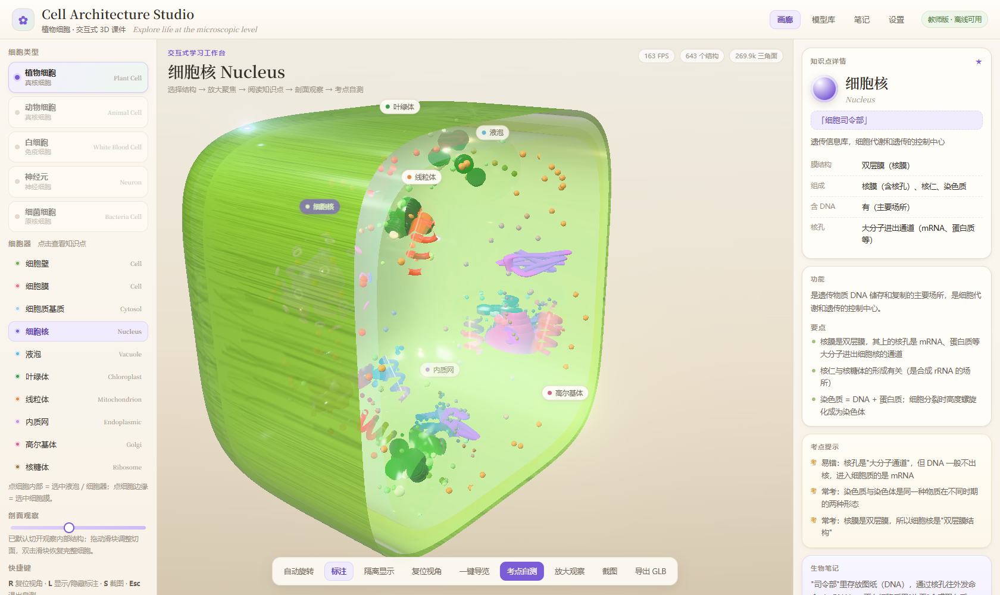

# 植物细胞标本室 · 完整版交互式 3D 课件



> **在线体验：** https://boy438.github.io/plant-cell-studio/

面向高中生物的交互式 3D 课件「标本室」版本。细胞模型由代码程序化生成，**不依赖任何外部模型文件**，
10 个细胞器可点选查看结构与功能，支持剖面观察、单独放大、随堂测验，还能一键导出 GLB。

## 功能一览

| 功能 | 说明 |
|---|---|
| 3D 探索 | 拖动旋转、滚轮缩放、双击复位；WebGL 实时渲染 + 柔和辉光 |
| 10 个细胞器 | 细胞壁、细胞膜、细胞质基质、细胞核、液泡、叶绿体、线粒体、内质网、高尔基体、核糖体 |
| 剖面观察 | 滑块切开细胞，看清各结构在内部的位置关系 |
| 单独放大 | 选中细胞器后聚焦观察，右侧「结构详情」同步给出功能与考点 |
| 随堂测验 | 内置小测，适合课堂互动检验 |
| 导出 GLB | 一键导出当前细胞模型，可用于 3D 打印或二次编辑 |
| 多细胞类型 | 界面已预留动物细胞、白细胞、神经元、细菌细胞（数据与模型待补） |

## 技术栈

- **渲染**：Three.js（`vendor/` 本地打包，`three.module.js` + `jsm/` 扩展，importmap 引入，无需 CDN）
- **建模**：`src/cellFactory.js` 用代码生成各细胞器几何（球体 / 胶囊 / 环面 / 自定义 BufferGeometry）
- **后期**：`EffectComposer` + `UnrealBloomPass`
- **交互**：raycast 拾取 + `CSS2DRenderer` 中文标签（标签始终朝向镜头）
- **可选 AI 重建模型**：把 TripoSR / 商用 API 生成的 GLB 放到 `models/<细胞器id>.glb` 并打开 `src/main.js` 中的开关即可替换为 AI 网格；
  `models/_examples/chloroplast-triposr.glb` 是一份实验样例，`tools/ai3d/` 为当时的单图重建脚本

## 目录结构

```
index.html          入口：importmap 与界面结构
assets/style.css    界面样式
src/main.js         渲染、交互、剖面、导出等主逻辑
src/cellFactory.js  程序化建模（细胞器几何生成）
src/knowledge.js    知识点数据：细胞类型 / 细胞器 / 测验
vendor/             Three.js 与 addons 本地副本
models/             可选 GLB 模型（含一份叶绿体实验样例）
tools/              辅助工具：GLB 查看、器官截图、AI 重建脚本
_shots/             各功能实拍截图
```

## 本地运行

因为用了 ES module，直接双击 `index.html` 会被浏览器的 CORS 拦下，需要起一个本地服务：

```bash
python -m http.server 8080
# 浏览器打开 http://127.0.0.1:8080/
```

## 授权与致谢

- 本仓库代码：MIT，可自由用于教学与二次开发
- Three.js：MIT，版权归其作者
- 设计灵感来源：Dilum Sanjaya 的 *Cell Architecture Studio*；本仓库为独立实现，未使用其素材文件

---

如果这份课件对你的课堂有用，欢迎 Star ⭐，也欢迎提 Issue 说想要哪个章节。
